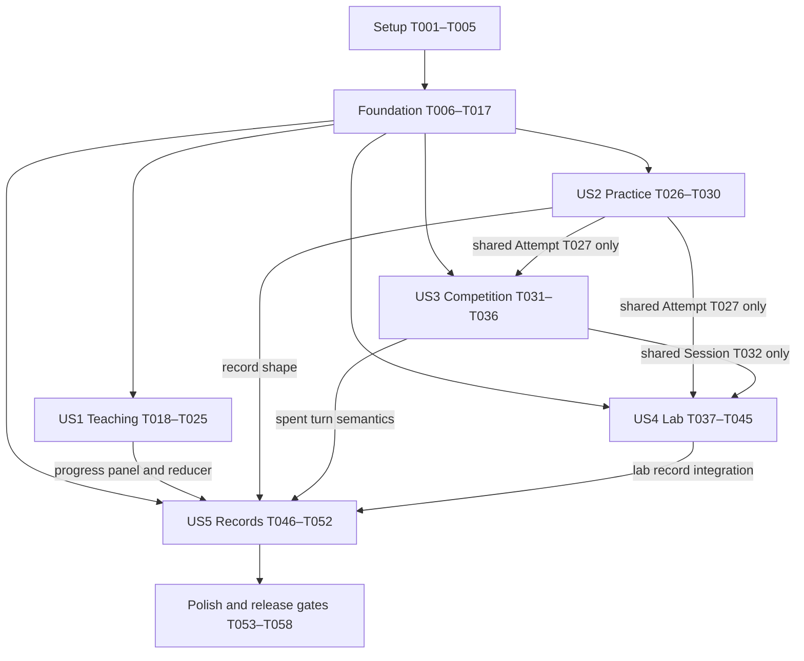

# Tasks: آموزش فارسی گراف و مدل‌سازی

**Input**: Design documents from `specs/001-persian-graph-learning/`

**Prerequisites**: [plan.md](plan.md), [spec.md](spec.md), [research.md](research.md),
[data-model.md](data-model.md), [contracts/](contracts/), [quickstart.md](quickstart.md),
and `.specify/memory/constitution.md`.

**Organization**: Tasks are grouped by user story; all paths are repository-relative.
This file defines work, not completed implementation. All boxes start unchecked.

**Validation**: Manual mobile/desktop browser acceptance checks plus the dependency-free
local script `node scripts/validate-content.mjs`. No automated test suites, test runner or
browser automation dependency. Record actual browser/device and script outcomes per story;
Node.js is optional developer tooling for the lightweight script, not a product runtime.

**مرجع جاری — ۲۰۲۶-۱۱-۱۲**: بانک `docs/question-bank.json` نسخهٔ ۱٫۴ و گزارش
`docs/question-bank-v1.4-report.md` مبنای T006/T015–T017 هستند؛ هر ۱۵۰ سؤال طبق
ممیزی بانک قابل استفاده‌اند و Q134 جایگزین شده است. گزارش‌های قبلی و شواهد اجرای
۱٫۲ در بخش‌های تاریخی حفظ می‌شوند و تأیید اجرای ۱٫۴ نیستند. این نوبت فقط spec و
tasks را هماهنگ می‌کند؛ هیچ کد/قرارداد/بانک یا تسک فاز ۸ تغییر اجرایی نمی‌کند.
PR#1.1 (PR واقعی #8) مرج شده؛ ابتدای این نوبت فایل‌ها تمیز و PR بازی موجود نبود.

## Format: `[ID] [P?] [Story] Description`

`[P]` means different files and independent work within the stated prerequisite batch;
it never overrides dependencies. Story phases require `[US1]` through `[US5]`.
Every task has an exact target path. Human review/evidence tasks must record actual outcomes,
not invent approvals, book-source verification, host results or student observations.

## Path Conventions

Browser files: `index.html`, `assets/css/`, `assets/js/`, `assets/vendor/`, `assets/content/`.
Static content: existing `docs/question-bank.json` and supplements under `content/`.
Developer validation: `scripts/validate-content.mjs`; evidence under
`specs/001-persian-graph-learning/validation/`.
No database, backend, compilation or runtime package installation is permitted.

**Applies after every completed code slice**: run `graphify update .`, review generated
`graphify-out/` changes and record the outcome in that slice's evidence/PR. When its graph
exists, query Graphify before source searches/reads; follow AGENTS.md navigation rules.
One independently reviewable feature per PR, with human approval before merge. Foundation
may use separate narrowly scoped PRs; do not combine all five stories into one implementation PR.

## Phase 1: Setup (Shared Infrastructure)

**Purpose / Goal**: Establish directly serveable assets and development conventions.

**Independent Test**: Serve repository files with a static HTTP server; no build command is needed.

- [X] T001 Create the static Persian document shell in `index.html`, module entry in `assets/js/app.js` and `.nojekyll`; set lang=fa and dir=rtl, use only relative asset URLs and reserve exactly five tab panels without implementing story workflows.
- [X] T002 [P] Acquire pinned official KaTeX browser JS/CSS/fonts into `assets/vendor/katex/` and record exact version, upstream URL, checksum and license in `assets/vendor/katex/PROVENANCE.md`; serving must not depend on a CDN.
- [X] T003 [P] Acquire official Vazirmatn WOFF2 into `assets/vendor/vazirmatn/` and record version/checksum/OFL license in `assets/vendor/vazirmatn/PROVENANCE.md`; keep Persian and mathematical font families separate.
- [X] T004 [P] Define the bank’s educational day/night palettes, typography and semantic graph/status/focus tokens in `assets/css/tokens.css`; implement base/layout/graph rules in `assets/css/base.css`, `assets/css/layout.css` and `assets/css/graph.css`, with every color/font consumed from tokens and normal-text contrast >=4.5:1.
- [X] T005 Document build-free static serving, Node.js 22+ development-only validation, manual mobile/desktop browser acceptance workflow and the one-feature/one-PR/human-review/Graphify workflow in `README.md`; preserve existing applicable guidance.

**Checkpoint**: Setup complete; vendor acquisition and basic serving are evidenced, not assumed.

Implementation scope (2026-11-10): T001–T005 complete, evidence in
[validation/phase-1.md](validation/phase-1.md). At the user's explicit request this slice
also supplies shell-only hash navigation and theme persistence from T013; T013 stays unchecked
because integration with the future repository remains deferred. No foundation/domain logic
or tab workflows beyond this requested shell are implemented. Stop here for human review.

---

## Phase 2: Foundational (Blocking Prerequisites)

**Purpose / Goal**: Provide shared content, mathematics, persistence and interaction boundaries before stories.

**Independent Test**: Load a ready modeled question, evaluate its graph, render math and safely commit/reload a validated empty state.

- [ ] T006 [P] Align source/supplement validation and adaptation in `assets/js/data/{validate,load,adapt}.js` and the source rules in `specs/001-persian-graph-learning/contracts/content.md` with `docs/question-bank.json` v1.4. Enforce exactly Q001–Q150, category A–F, difficulty 1–3, three hints, known sahat and tab permissions. Resolve effective mode as response_mode_by_tab[tab] > response_mode > legacy type; validate all ten modes, figure_ref and directed/multigraph flags without treating them as simple graphs. Q055/Q114 are usable through text despite n=14/16; keep the exact-engine limit 12 and custom limit 2–10. Q001–Q003 and Q008–Q011/Q014 must bypass undirected domination. Distinguish complete bank content from implemented renderer/evaluator/assets/reachability; missing modeling alone must not reject definition/proof/runtime questions, while constitution-required modeled presentation still needs a valid supplement. Load relative to module base and expose explicit unsupported-mode states. Audit stale overrides against corrected source rather than overwriting v1.4. Plan bank-version compatibility with T017; changing a version string alone grants no compatibility.
- [X] T007 [P] Implement canonical topology, vertex/edge validation and layout-independent operations in `assets/js/domain/graph.js`; enforce “unique IDs; edge endpoints exist; count matches n; simple evaluator rejects loops/direction/parallel edges”. Keep directed/multigraph introductory models displayable through distinct types; custom graphs are 2–10 vertices, prepared graphs may have 12.
- [X] T008 [P] Define envelope validation and conservative version dispatch in `assets/js/storage/validate.js` and `assets/js/storage/migrate.js`; enforce schemaVersion=1 (“unsupported versions rejected without overwriting”), curriculumVersion=1 (“incompatible curricula rejected pending explicit migration”), revision a “nonnegative integer”, attempts “excludes teach entirely”, sessions “practice/competition/lab only”, theme “day/night” and “allowlist; no arbitrary executable configuration”. Accept only known fields and valid references; never coerce incompatible state into defaults. Define shared user limits in `assets/js/domain/limits.js`: group name <=30, user label <=50, text response <=1000 Unicode code points after NFC (trim names/labels only), live Attempt count <=200 and Session count <=100. Apply identical allowlisted rules to every local write and pre/post-merge import; refuse overflow without truncation, partial commit or eviction. Validate turn resultStatus pending|finalized|finalized-deleted and conditional nullable attempt references per data model.
- [X] T009 Implement exact closed-neighborhood domination, delete-one minimality, increasing-subset minimum enumeration and all-optimum acceptance in `assets/js/domain/evaluate.js` after graph primitives; output all fields from `contracts/evaluation.md`, cache by topology, handle isolated/edgeless/disconnected graphs and reject unknown selected IDs as invalid input rather than student errors.
- [X] T010 Implement pure quality scoring and hint caps in `assets/js/domain/scoring.js`: bases 0/5/10/15; practice unchanged by hints; competition final=min(base,cap) with caps 15/10/5/0 for 0/1/2/3 hints. Keep target correctness distinct from quality; no teaching score aggregation. The third cap remains the documented spec assumption.
- [X] T011 Implement one-envelope storage in `assets/js/storage/repository.js` after envelope validation: key `graph-learning:v1:<normalized-base-path>`, in-memory prepare plus one setItem, expected-revision check, revision increment only on success, corrupt/absent/unavailable states, recoverable unsaved memory and export access. Re-read revision; react to storage events and pause dirty cross-tab writes; never use localStorage.clear or silently evict data.
- [X] T012 [P] Implement safe text/math and feedback helpers in `assets/js/ui/math.js` and `assets/js/ui/feedback.js`; render text as text nodes, delimit math into left-aligned isolated LTR spans, use KaTeX trust=false, keep fallback readable and show Persian errors/confirmations inline without alert/confirm/prompt or modals.
- [X] T013 Implement five hash tabs, keyboard/ARIA navigation and persisted theme selection in `assets/js/ui/tabs.js` and integrate `assets/js/app.js`; support browser back/forward, unknown-hash fallback, inline storage status and no server-side route rewrite.
- [X] T014 Implement shared accessible SVG graph selection and editing in `assets/js/ui/graph-editor.js`; provide touch/keyboard selection, drag with normalized positions and non-drag alternatives, add/remove edges, distinguish selection from drag/submit and display vertex/edge meanings with the graph. Mathematical evaluation must not change from dragging alone.
- [ ] T015 Audit presentation/integration of all 150 usable v1.4 IDs in `content/question-overrides.json` and required assets under `assets/content/`, against `docs/question-bank-v1.4-report.md` and `docs/گسسته-دوازدهم.pdf`; prior reports are historical, not current missing-content lists. Preserve identity/lesson/sahat/tab permissions and source/human-review provenance. Reconcile supplements with all report corrections, especially Q019 text, Q025/Q107 new graphs, Q064 supplied sets, Q078, Q135 changed topology and Q150 edge vz. Q134 is a replacement: n=3 one edge plus isolated vertex (two optimum sets), n=4 C4 (six), n=1/2 impossible; remove old assumptions without inventing credit. Provide the ten figure_ref uses (Q001/Q002/Q003/Q022/Q023/Q025/Q028/Q107/Q112/Q113) from verified book assets; no invented hospital distances/edges. Map Q003 multigraph drawing, Q014 directed drawing, Q041 board, Q141/Q142/Q143 runtime library and Q146 lab activity to actual permitted UI paths, without claiming they already work. Reconcile graph-free definitions/proofs with modeled product presentation and self-assessment rubrics; retain the authored 12-step APOS path. Record remaining human checks for Q109 derived attribution and Q112/Q113 printed figure. Resolve the Q141 source no-report/speed-score description versus the product's persisted challenge before changing behavior; do not silently import source policy into product scoring/storage. Record required follow-up in `specs/001-persian-graph-learning/contracts/{content,evaluation,ui,persistence}.md` before implementing it.
- [ ] T016 Implement `scripts/validate-content.mjs` using shared validation and independent checks against v1.4: exact 150 IDs, category/APOS/tab/teaching references, three hints, six sahat counts 60/25/20/15/15/15, effective response modes, required figure assets and graph endpoint integrity. Derive counts from records: 93 graphs/135 modeling; 8 directed-or-multigraph records with null gamma and 85 simple undirected graphs. Check simple-graph gamma, every supplied optimum set and optimum counts independently, including 14/16-vertex sources offline without expanding the runtime limit; verify directed orientation/multigraph edge multiplicity separately. Explicitly check Q134 n=3/4 solutions and n=1/2 impossibility, Q135 and Q150 corrections. Report metadata/report mismatches (actual text=31/compute_gamma=39 versus meta 30/40; 10 figure_ref uses versus 9 default figure_text; report graph split 88+5 versus actual 85+8) instead of trusting summary counts or mutating the source. Treat historical practice_ready=114/126 as a field-presence metric, not 12 unusable questions. Validate text/proof self-assessment and all tab-specific/runtime modes, plus simple-cycle valid n, separately from full reachability/readiness. Report bank validity, asset availability, runtime support and human review distinctly; release mode fails for missing required assets or unreachable/unready product paths. Reported bank audit is not evidence that this script has run.
- [ ] T017 Run the foundation smoke verification from `quickstart.md` and record exact outcomes in `specs/001-persian-graph-learning/validation/foundation.md`: v1.4 loading, each effective mode/figure/runtime dependency and explicit unsupported states, static subpath loading, math fallback, exact small-graph cases, successful/failed writes, no extra storage backend and Graphify update. Before modifying storage/transfer compatibility, document and verify policy for local state/backups from banks 1.1/1.2/1.3/1.4 in `specs/001-persian-graph-learning/contracts/persistence.md`; same ID must not reinterpret old Q134 responses/scores or pending turns as the replacement. Preserve valid APOS curriculum=2 progress, unrelated results, consumed/deleted-turn semantics and atomic failure behavior; do not reset everything merely because the bank changed. Verify export/import/capacity and corrected source versus stale overrides with actual supported data. Record unresolved Q141 policy, printed-source/human review and runtime integration work without fabricated passes. This is an unexecuted task definition; do not run phase-8 T053–T058 under this documentation-only authorization.

**Historical scheduling amendment (user, 2026-11-11)**: T008/T011/T012 were completed before phase 4.
The later request moves T006 and T015–T017 forward from their previous pre-release deferral:
complete the question-bank work before starting the next feature phase. They remain unchecked;
this documentation-only alignment does not implement them. Every consumed question needs a
valid model/reference/assessment contract, and human educational review remains a release gate.
T014's unbuilt topology editing remains required for the Lab feature.

**Current boundary (user, 2026-11-12)**: Only the v1.4 documentation alignment is
authorized now. T006/T015–T017 above define remaining integration/verification work, not
missing bank authorship and not completed work. Their historical unchecked state stays
unchanged. Do not execute those tasks or phase 8 in this turn; stop for review of spec/tasks.

**Checkpoint**: Shared storage/math/feedback interfaces are ready for later tab controllers;
full source readiness and integrated foundation/release smoke checks remain pending.

Historical phase-2 review slice (2026-11-10): user authorized only SVG selection, exhaustive
assessment, quality scores/hint caps and the liquid-glass presentation amendment.
T007/T009/T010 are complete. T014 is selection/keyboard/mobile rendering only; topology
editing/dragging is deferred, so its checkbox stays open. T006/T008/T011/T012/T015–T017
and all story workflows are deferred. The preview in `assets/js/ui/board-preview.js` is
not a teaching/practice/competition controller and creates no records or persistent scores.
Validate with `node scripts/validate-graph.mjs`; see [validation/phase-2.md](validation/phase-2.md).
Stop for user review after this slice.

---

Foundation follow-up (2026-11-11): T008/T011/T012 are complete. Evidence:
[validation/storage-foundation.md](validation/storage-foundation.md). Shared strict envelope,
record/session/reference/turn validation, limits, conservative version dispatch, complete-state
commit/expected revision, unsaved recovery, dirty-form cross-page conflict handling and shared
math/feedback/inline confirmation helpers are implemented. Teaching uses these helpers.
No Practice/Competition/Records/Lab flow was added. T006/T015–T017 remain pre-release gates;
import/merge UI and producer controllers/factories remain their later story tasks. Stop for review.

Revalidation against bank v1.2 (2026-11-11): T008/T011/T012 remain complete; 104 foundation
checks and 46 Teaching checks pass. Fixed the stale Teaching supplement version after
confirming all eight referenced source questions are unchanged, and passed the loaded bank
version to recovery exports. See the revalidation section of the evidence above. No phase-4
workflow was started; stop for human review.

## Phase 3: User Story 1 - یادگیری مرحله‌ای (Priority: P1) — MVP

**Purpose / Goal**: Deliver APOS self-assessment with persistent monotonic progress and isolated reset.

**Independent Test**: Complete one stage, refresh, return and answer incorrectly: pass/unlock remains; cancel then confirm reset: only teaching progress clears. Inspect storage: no teaching responses/scores/hints.

- [X] T018 [P] [US1] Create four ordered APOS sections and lesson blocks in `content/teaching.json`; enforce “exactly four, nonempty required list; prerequisites sequential” with Action/Process/Object/Schema order 0–3. Each activity has stable id/questionId/stageId and target dominating|minimal|minimum; enforce “source tab includes teach; APOS matches; graph supports target evaluator” without relabeling unrelated source questions.
- [X] T019 [P] [US1] Implement pure monotonic progress transitions in `assets/js/domain/progress.js`: completedActivityIds, passedStageIds as the sequential completed prefix, lastVisitedStageId restricted to unlocked stages; “Current percent = 25 * passed prefix length”. No independent percentage/unlock flags or teaching timestamps, answers, selected vertices, hint counts or scores; reset clears only this progress subtree.
- [X] T020 [US1] Implement stage selector, locked reasons, 0/25/50/75/100 percent and previous/continue navigation in `assets/js/tabs/teach.js`; after curriculum and progress are ready, restore last visited unlocked stage through repository, block direct-link bypass and keep every passed/open stage available on backward navigation.
- [X] T021 [US1] Implement target-specific teaching interactions in `assets/js/tabs/teach.js` with graph selection/evaluation and inline feedback: accept dominating/minimal/minimum according to the requested target, explain uncovered/removable/smaller-set failures, automatically show a suitable free hint below the question before a separate full-answer action; reveal alone never completes an activity.
- [X] T022 [US1] Persist only accepted completion flags and navigation from `assets/js/tabs/teach.js`; all required activities must pass before unlocking the next stage. Wrong review answers cannot remove flags, reduce percent or relock previously open stages; reload resumes partial completion without restoring old answers.
- [X] T023 [US1] Implement confirmed inline “شروع از اول” in `assets/js/tabs/teach.js` using the progress-only reset; cancel does nothing, confirm returns to Action/0%, failed storage shows unsaved status, and practice/competition/lab records and settings are untouched.
- [ ] T024 [US1] Add the minimal teaching progress panel to `assets/js/tabs/records.js`, wired through `assets/js/app.js`; show percent/passed stages/continue destination and the same reset action without teaching scores or attempt counts. This US1 slice is independently usable before US5 analytics.
- [ ] T025 [US1] Execute US1 acceptance scenarios and record evidence in `specs/001-persian-graph-learning/validation/us1.md`: all five progress values survive reload, direct links respect locks, wrong review leaves unlock intact, partial flags resume, reset cancel/confirm/failure preserve unrelated data, and storage contains no teaching attempts/responses/scores/hints; inspect transfer allowlist when US5 lands.

Scoped phase-3 review slice (2026-11-11): per the user's explicit “Teaching tab only”
authorization, T018–T023 are implemented. T024 is deliberately deferred; Records, Practice,
Competition and Lab remain their existing placeholders. T025 has teaching-only local/browser
evidence in [validation/us1.md](validation/us1.md), but stays open for its Records/transfer
integration checks. Eight source-backed modeled activities are ready for user review; human
educational approval and full page-by-page book validation remain release gates (T053).

Necessary foundation subsets are implemented for this slice: teaching content/reference
validation in data/{load,validate}.js, safe math rendering, and a revision-checked one-envelope
repository that patches only progress/theme. Shell theme migrates after a successful write.
At the phase-3 checkpoint T006/T008/T011/T012/T015–T017 were unchecked. The foundation
follow-up below supersedes that storage/math/feedback limitation; full-bank work remains pending.
The recovery-only download is available on storage failure; no import/Records workflow was started.
T013 now integrates with the repository and is complete. T014 remains selection-only.
Stop for human review; do not proceed to the next story.

**Checkpoint**: US1 MVP is independently demonstrable after setup/foundation; human review is required before merging its feature PR.

---

## Phase 4: User Story 2 - تمرین تکمیلی (Priority: P1)

**Purpose / Goal**: Deliver independently scored extra practice with free hints and honest response modes.

**Independent Test**: Without passing teaching, select easy/hard exercises, finalize responses and retry; verify free hints preserve score and teaching progress is unchanged.

- [X] T026 [P] [US2] Implement question filtering/selection in `assets/js/tabs/practice.js`: allowed practice tab only, lesson/category filter, easy difficulty=1, hard difficulty=2 or 3; preserve source difficulty and show explicit no-question/unready states.
- [X] T027 [P] [US2] Implement recorded Attempt factories and validation in `assets/js/domain/attempts.js` with the fields in `data-model.md`: “At least questionId or lab activityId exists”, custom activity snapshot, tab practice/competition/lab only, mode-specific evaluation, stable IDs/time and “Finalized response is immutable”. Text rubric accepted=10 otherwise=0, explicitly labeled self-assessment; never represent it as machine-verified. Enforce the shared <=1000-character text response, <=50-character user labels and <=200-live-Attempt limits in local recording; preserve teaching flags when capacity blocks a record. Deleted result markers are session metadata, not Attempts.
- [X] T028 [US2] Connect selection/integer/graph-construction/self-assessed-text response modes to reviewed rubrics and shared evaluator in `assets/js/tabs/practice.js`; show explanations and three free sequential hints, with no automatic free-text correctness claim and no teaching unlock effect.
- [X] T029 [US2] Finalize and persist practice outcomes from `assets/js/tabs/practice.js` through attempt/repository interfaces; finalize once per attempt, retry creates a fresh ID, record hintLevel/baseScore/finalScore and valid session references while teaching responses remain excluded.
- [X] T030 [US2] Execute US2 acceptance checks and record outcomes in `specs/001-persian-graph-learning/validation/us2.md`: independent access, filter boundaries/empty state, each response mode, retry identity, unchanged score for 0–3 hints, correct stored result and unchanged teaching progress.

**Checkpoint**: Practice can run without completing US1; attempt interface is now shared by competition and lab.

---

Phase-4 review slice (2026-11-11): T026–T030 implemented against bank v1.2.
Four response modes, free hints, explicit finalization/retry and persistent results are
available through 14 adapted source activities. Unprepared IDs remain visible and disabled;
this is not completion of T006/T015–T017 or human educational review. The user's latest
explicit phase-4 request authorizes this scoped slice despite the earlier bank-first
scheduling amendment. No later-phase workflow was started. Evidence: [validation/us2.md](validation/us2.md).
Stop for human review.

## Phase 5: User Story 3 - مسابقهٔ گروهی (Priority: P2)

Randomization amendment (same PR, user-requested): replace shared questions with random
distinct IDs of the same exact difficulty per round; validate sufficient pool capacity and
persist assignments before play. Add in-memory teaching pools constrained to original APOS/
exact difficulty with stable target/completion IDs, and exact-difficulty random practice
options respecting filters. Update T018/T026/T031–T036 implementations and their validation;
verify no teaching responses/assignments are persisted, no within-round duplicates, retained
competition assignments on reload/reset, empty/singleton pools and no record until finalize.
This amendment supersedes the earlier same-question-per-round policy; other phase boundaries remain.

**Purpose / Goal**: Deliver equal-turn local group competition with persisted hint caps and immutable results.

**Independent Test**: Complete a match at each integer group count 2–10, verify caps and shared ranks, reload during an active hinted turn and ensure no score/cap reset.

- [X] T031 [P] [US3] Define round defaults, eligible question references and cap table in `content/competition.json`; enforce “rounds positive integer; eligible question types and tab permission enforced”, allowed types interactive_graph/compute_gamma and caps 15/10/5/0. Adapt numeric-gamma competition interaction to vertex selection without changing source IDs/type metadata.
- [X] T032 [P] [US3] Implement session/turn state in `assets/js/domain/sessions.js`: status “configured/active/completed”, stable group/turn IDs, “count 2–10 for competition and exactly 2 in lab station 5”, positive rounds and equal-turn allocation by difficulty. Persist question choices/hints before display, one finalized answer per turn, absolute deadline when present, and totals derived from attempts; deleted results leave a spent turn. Enforce <=30-character group names and <=100 stored sessions. Represent each turn with resultStatus=pending|finalized|finalized-deleted: pending/deleted has finalizedAttemptId=null, finalized requires a matching existing Attempt; both finalized states remain spent. Deleted state contains no response/score/evaluation copies.
- [X] T033 [US3] Implement group names/count, positive round setup, active-group/round UI and equal-level pool selection in `assets/js/tabs/competition.js` after config/session interfaces; reject 1/11/fractional counts, disclose pool-cycle repeats, show inline empty pool errors.
- [X] T034 [US3] Implement hint button, visible cap and final-answer commit in `assets/js/tabs/competition.js`; min(base,cap), not subtraction; persist consumedHintLevel before reveal, allow exactly one finalized attempt per turn, disable scoring inputs afterward and reset caps only on the next turn.
- [X] T035 [US3] Implement resume, final totals and shared-rank results in `assets/js/tabs/competition.js`; recompute totals from retained attempts, restore active turn/hint level on reload, handle storage conflicts without replaying finalized turns and never use a hidden tie-break.
- [X] T036 [US3] Execute US3 verification and record outcomes in `specs/001-persian-graph-learning/validation/us3.md`: every count 2–10, invalid boundaries, equal turns, eligible pool exhaustion, 0/5/10/15 quality by all caps, hinted-turn refresh, immutable finalization and shared ranks; later deletion checks reuse US5.

**Checkpoint**: Competition consumes the shared attempt/session model, not US1 teaching completion.

Phase-5 slice (2026-11-11): T031–T036 implemented with seven modeled eligible questions,
shared questions per round for equal difficulty, durable consumed hints, one-shot finalization,
resume, spent deleted-turn handling and shared ranks. The latest user request authorizes only
this phase; full-bank/human content gates remain open. Evidence: [validation/us3.md](validation/us3.md).
Stop for human review before phase 6; do not merge automatically.

User-requested phase-5 follow-up: add reset/delete controls with inline confirm/cancel for
active and completed matches. Reset removes the chosen execution/results and starts a fresh
identity with unchanged groups/rounds/questions and zero hints; delete removes that whole
match/results. Use a narrow repository action, expected revision and one write; preserve
other sessions/records and teaching progress. This explicit whole-match action is separate
from future US5 selected-result deletion/tombstones. Verified in validation/us3.md.

---

## Phase 6: User Story 4 - کاوش در آزمایشگاه (Priority: P2)

**Purpose / Goal**: Deliver all five modeled lab stations and the shared custom/drawing/timed tools.

**Independent Test**: Use every station independently, drag without changing mathematics, contrast minimal/minimum and resume a timed challenge past its deadline without accepting new answers.

- [X] T037 [P] [US4] Define five modeled stations/templates in `content/lab.json`: gamma calculation, formula discovery, bounds/edge effects, minimal versus minimum and two-group game; enforce “exactly five; valid references and modeling contexts”. Set custom n=2–10 and timed challenge=5 graphs/180 seconds; no extra top-level tabs.
- [X] T038 [US4] Implement lab station selector, explanatory models and saved explicit activity submission in `assets/js/tabs/lab.js`; use shared attempts/sessions, record question IDs when applicable and custom activityId/graphSnapshot otherwise; free editing does not fabricate scored attempts or sahat coverage.
- [X] T039 [US4] Implement modeled custom construction, vertex bounds, add/remove edges, dragging and keyboard position controls in `assets/js/ui/graph-editor.js` and integrate `assets/js/tabs/lab.js`; reject n outside 2–10, keep ready 12-vertex source models accessible without applying custom bounds, and separate topology from positions.
- [X] T040 [US4] Implement draw-by-n/gamma exercise in `assets/js/tabs/lab.js`: integer validation, 2<=n<=10 and 1<=gamma<=n for simple custom graphs; student draws then exact evaluator checks actual n/gamma and explains mismatch without supplying a guessed graph.
- [X] T041 [US4] Implement stations 1 and 2 in `assets/js/tabs/lab.js`: direct gamma exploration, valid alternative optimal sets and family formula investigation with reviewed examples; distinguish observations from a proof of a general formula.
- [X] T042 [US4] Implement stations 3 and 4 in `assets/js/tabs/lab.js`: edge-add/remove before/after gamma and bounds comparisons, delete-one minimality and exact minimum comparison; show uncovered/removable vertices and counterexamples where a minimal set is not minimum.
- [X] T043 [US4] Implement station 5 local two-group game in `assets/js/tabs/lab.js` using session/turn invariants; keep its records under lab, not competition, with exactly two stable groups and model context.
- [X] T044 [US4] Implement the five-graph/180-second challenge in `assets/js/tabs/lab.js`; persist chosen models/deadline, recheck absolute time on submit/resume/visibility change, disallow fresh finalization at timeout and store only finalized results once.
- [X] T045 [US4] Execute US4 acceptance checks and record outcomes in `specs/001-persian-graph-learning/validation/us4.md`: all five stations, n endpoints/out-of-range, draw targets, multiple optimums, isolated/edgeless models, invariant drag results, topology edits and timeout after hidden-tab/reload; custom untagged activity must not create sahat evidence.

**Checkpoint**: All stations are independently usable through foundation and shared recorded-activity interfaces.

Phase-6 implementation slice: five modeled stations, 2–10 custom builder, prepared-model
loading, edge toggles, SVG pointer/keyboard positioning, n/gamma drawing check, exact deletion/
minimum diagnostics, a two-group lab game and persistent 5-model/180-second challenge.
T014's remaining editor portion is now supplied through the opt-in editable-board wrapper.
Evidence: [validation/us4.md](validation/us4.md). Stop for human review; phase 7 is not started.

Lab browser-review follow-up (comments 1–5): symmetric movement pad; compact pair-based and
board-click edge editing; actionable preflight for large prepared/custom-draw mismatch;
separate builder/prepared/target panels with explicit applied model; independently verify
family topology and functional station-specific checks/observations/game. Record mobile/
desktop and day/night results under validation/us4.md and update the same phase-6 PR.

Second lab review: explain/deduplicate transient family observations and add remove/clear
controls; show active station title, goal and a jump to its dedicated task; distinguish
temporary notes from recorded Attempts. Add lab-only result list and revision-checked
confirmed deletion, with spent turn markers for game/challenge results. Explain the global
lesson/page footer as reference-only. This limited precursor does not complete T049–T052
or authorize the phase-7 analytics/transfer UI. Record mobile/desktop evidence in us4.md.

Populated-result layout correction: override the global full-width button style in rows,
reserve a flexible text column, separate title/score/time, and verify populated results in
mobile/desktop and both themes. This does not change stored data or the storage schema.

---

## Phase 7: User Story 5 - تحلیل و مالکیت سوابق (Priority: P2)

**Purpose / Goal**: Deliver analytics/coverage, isolated selected deletion and validated progress-preserving transfer.

**Independent Test**: Use fixture data from three recorded tabs plus teaching progress; verify unique coverage, exact selective deletion, round-trip transfer/idempotence and all-or-nothing invalid import.

- [X] T046 [P] [US5] Implement derived six-sahat coverage and analytical aggregates in `assets/js/domain/coverage.js`: “unique questionIds in remaining attempts / total bank IDs for that tag, multiplied by 100”; count attempts separately, exclude teaching flags and untagged custom lab activity, show zero/no-data without personality claims.
- [X] T047 [P] [US5] Implement UTF-8 JSON export and strict complete-candidate validation in `assets/js/storage/transfer.js` per persistence contract: format `persian-graph-learning-backup`, schemaVersion=1, curriculumVersion=1, and “import file limit of 5 MiB”; use the tested bankVersion=1.2-only policy (reject 1.1 without mutation because reference answers changed), with no silent loss or reinterpretation of old results. Do not export teaching answers/scores/hints, authoritative revision or derived caches. Validate IDs/references/enums/finite numbers/timestamps, reject unsafe keys/markup and recompute derivable scores. Use `assets/js/domain/limits.js` identically for NFC/counting and limits 30/50/1000/200/100; preserve deleted-turn status and validate that finalized-deleted has null attempt reference, while finalized points to a valid result.
- [X] T048 [US5] Implement deterministic import merge in `assets/js/storage/transfer.js`: union compatible teaching completion flags/recompute prefix without lowering progress; preserve valid local location/theme, deduplicate identical stable records, reject conflicting duplicate content/curricula and reconcile active-session conflicts. Preview restoration from old pre-reset backups; commit only after inline confirmation in one repository write, cancel/failure changes no persisted state. Validate the merged candidate against 200 live records/100 sessions. For matching turn identity/context, finalized-deleted wins over pending/finalized, suppresses the associated old Attempt and never revives a result; identity mismatch still rejects the complete import. Show suppressed old results in preview.
- [X] T049 [US5] Extend `assets/js/tabs/records.js` beyond the US1 progress panel with practice/competition/lab attempts, outcomes, scores/hints and lesson/APOS breakdowns; show counts and unique six-sahat coverage separately, subscribe to updates and show truthful no-data states. Display «حذف‌شده» for finalized-deleted turns without counting them as outcomes/scores/coverage; do not offer replay.
- [X] T050 [US5] Implement selected-record deletion in `assets/js/tabs/records.js` and shared repository operations in `assets/js/storage/repository.js`: inline impact preview/confirm/cancel, remove only selected attempt IDs, retain spent finalized-turn markers, derive totals/coverage again and leave teachingProgress unchanged; teach reset remains a distinct action. Atomically remove the Attempt and set resultStatus=finalized-deleted, finalizedAttemptId=null; preserve the marker and purge per-turn result copies.
- [X] T051 [US5] Wire export/download, file picker, import preview/confirm/cancel and useful validation/quota/conflict messages into `assets/js/tabs/records.js`; expose export of unsaved in-memory work and preserve displayed local progress until a validated commit succeeds.
- [X] T052 [US5] Execute US5 verification and record outcomes in `specs/001-persian-graph-learning/validation/us5.md`: fresh-browser export/import equality, repeat-import idempotence, old backup preview, impossible stage jump rejection, corrupt/oversized/incompatible files, conflicting IDs, quota failure, teaching answer exclusion and progress preservation; deletion must affect only selected data and never grant replay of a competition/challenge turn. Check deleted-turn export/import plus older-backup precedence, null reference validation and no replay; manually check exactly-at/one-over boundaries 30/31, 50/51, 1000/1001, 200/201 and 100/101 in local writes and import, including merged totals overflowing capacity.

**Checkpoint**: All five user journeys can now integrate; analytics can also be checked independently with validated fixtures.

Phase-7 implementation: T046–T052 complete; see validation/us5.md for exact script/browser evidence and remaining physical-device/human-review limits. The 1.1 backup policy is explicit rejection pending reviewed migration. No phase-8 task is started; stop for review of the phase-7 PR.

---

## PR#1.1: بازطراحی آموزش APOS — گیت تأیید پیش از پیاده‌سازی

**وضعیت جاری ۲۰۲۶-۱۱-۱۲**: طرح با ریست پیشرفت قدیمی به صفر تأیید و بازنویسی پیاده شده است؛ PR#1.1 (PR واقعی [#8](https://github.com/mmalborzi1384/dominating-graph-site/pull/8)) مرج شده است. عبارت‌های «توقف برای بازبینی/بدون مرج» در تسک‌های زیر، مرز تاریخی اجرای آن PR هستند. فاز ۸ مجوز اجرا ندارد.
طرح: [amendments/pr-1-1-apos-redesign.md](amendments/pr-1-1-apos-redesign.md).
تسک‌های تاریخی T018–T025 وضعیت اجرای نسخهٔ قبلی‌اند؛ آن‌ها گواه تکمیل بازنویسی نیستند.

- [X] APOS-D01 ثبت طرح پیشنهادی چهار ساختار، دوازده فعالیت با هدف/صورت/پاسخ/معیار، پیوستگی، پاسخ‌های متنوع و سیاست پیشنهادی پیشرفت در ضمیمه، spec و قراردادها؛ بدون تغییر کد.
- [X] APOS-G01 دریافت تأیید صریح کاربر برای طرح، تعداد/نوع فعالیت‌ها و سیاست اصلاح‌شدهٔ ریست پیشرفت قدیمی به صفر؛ این گیت با ساخت PR یا تأیید خودکار کامل نمی‌شود.
- [X] APOS-D02 پس از G01، نهایی‌کردن schemaVersion/نسخهٔ curriculum و مهاجرت ذخیره/بک‌آپ در contracts/persistence.md و data-model.md؛ نمونهٔ قبل/بعد، شروع آموزش قدیمی از صفر و حفظ تمام داده‌های سایر تب‌ها؛ بدون حذف خودکار داده.
- [X] APOS-C01 ممیزی تطبیق بانک/کتاب و تألیف دوازده فعالیت و پاسخنامه/راهنما و گونه‌های هم‌ارز در content/teaching.json و فایل محتوای جدا در صورت نیاز؛ نگاشت منبع و مجوز/APOS واقعی، بدون ساخت questionId جعلی یا بازتفسیر سؤال.
- [X] APOS-C02 قرارداد پاسخ‌های چندنوعی و قواعد مرحله/هدف/سختی/زنجیره را در data/{load,validate}.js تکمیل کن؛ مدل وابسته در بازقرعه‌کشی سازگار بماند؛ نوع فهم با درجهٔ سختی یکی گرفته نشود.
- [X] APOS-E01 ارزیاب‌های خالص توالی مسیر، برابری رابطه/مجموعه، پیش‌بینی، عدد و استدلال ساخت‌یافته را پیاده کن؛ ارزیاب پوشش دقیق را برای موارد مرتبط بازاستفاده کن؛ توضیح آزاد اختیاری و بدون تصحیح خودکار/قبولی باشد.
- [X] APOS-U01 در tabs/teach.js رندرهای Action عملی، Process ثابت و پیش‌بینی‌محور، Object رسمی و مفهومی، Schema ساخت/حل/نقد را بساز؛ اهداف، معیار، راهنما پیش از جواب، پل‌ها و ابزار لمسی/صفحه‌کلید درون صفحه باشند.
- [X] APOS-P01 پس از D02، مهاجرت و پیشرفت نسخه‌دار را در domain/progress.js، storage/{validate,migrate,repository,transfer}.js و نمای پیشرفت records.js تکمیل کن؛ تأیید و خروجی قبلی، بدون اعتبار قدیمی و با ریست فقط یک‌بارهٔ نسخهٔ ۱، reset مستقل، حفظ سایر داده‌ها و تقدم حذف.
- [X] APOS-V01 اسکریپت سبک و بررسی مرورگر موبایل/دسکتاپ و هر دو تم: تمام دوازده فعالیت، جواب‌های هم‌ارز، عدم نشت تعریف Action، مدل ثابت Process، زنجیره تصادفی، قفل/بازگشت/refresh/reset، مهاجرت و round-trip دو نسخه/شکست ذخیره/علامت حذف؛ شواهد واقعی در validation/apos-redesign.md.
- [X] APOS-R01 Graphify پس از هر تکه، به‌روزرسانی مستندات/PR و پیش‌نمایش؛ توقف برای بازبینی انسانی، بدون مرج و بدون شروع فاز ۸.

---

## Phase 8: Polish & Cross-Cutting Concerns

**Purpose / Goal**: Validate the complete static product and release gates without inventing deployment or review evidence.

**Independent Test**: All applicable acceptance checks, instructional review and host checks have recorded results; incomplete gates remain visibly incomplete.

- [ ] T053 [P] Run a complete content reachability/readiness audit with `scripts/validate-content.mjs` and record findings in `specs/001-persian-graph-learning/validation/content-audit.md`; require all 150 IDs accessible in an allowed tab, all APOS activities valid, modeling/context and required figures complete. Obtain and record human educational review of source pages 32–54/rubrics/figures; unresolved sources block release, never mark them approved automatically.
- [ ] T054 [P] Verify both palettes, KaTeX math/Latin isolation, keyboard/touch use and 360px/1280px layouts across Chromium/Firefox/WebKit; correct issues in `assets/css/tokens.css`, `assets/css/layout.css`, `assets/css/graph.css` and `assets/js/ui/` and record actual results in `specs/001-persian-graph-learning/validation/presentation.md`. Check ordinary-text contrast >=4.5:1, visible focus and non-color-only status.
- [x] T055 Measure exact evaluation <=12 vertices (<100ms target), pointer redraw (16.7ms target) and loaded-tab transitions (<200ms target); correct justified bottlenecks in `assets/js/domain/evaluate.js`, `assets/js/ui/graph-editor.js` and `assets/js/ui/tabs.js`, and record hardware/browser/dataset/timings in `specs/001-persian-graph-learning/validation/performance.md`.
- [x] T056 Validate static project-subpath asset loading and hosting prerequisites for GitHub Pages, Linux Nginx/Apache and Windows IIS per `quickstart.md`; record actual host/browser outcomes or untested limitations in `specs/001-persian-graph-learning/validation/deployment.md`. Update `README.md` with copy-only deployment/MIME instructions; prepare deployable files but publish to external hosts only when separately authorized.
- [ ] T057 Carry out the five-student usability protocol (4/5 locate/answer a practice question and find its result unaided), record observations in `specs/001-persian-graph-learning/validation/usability.md` and fix observed blockers; if participants are unavailable, record that pending release gate instead of fabricated results.
- [x] T058 Run the applicable end-to-end scenarios in `specs/001-persian-graph-learning/quickstart.md` and existing appropriate checks, inspect storage/export for teaching-data exclusion and validate no build/backend/storage drift; update `specs/001-persian-graph-learning/validation/release.md` with FR-001–025/SC-001–010 evidence, unresolved gates and each feature PR/human-review status. Complete the final code-slice Graphify update before requesting any merge/publication approval.

- [x] T059 Compact five-panel finite animated landings; preserve modeled content and editable copy.
- [x] T060 Shared bounded tab/glass/board/feedback/score/progress/unlock motion, hover and pressed states.
- [x] T061 Four-level glass radio rail; persisted/validated preference, reduced-motion precedence and immediate cancellation.
- [x] T062 Verify touch/keyboard at 360px/1280px in both themes, all four levels, reload and current-bank backup round-trip; record evidence and limitations.

**نتیجهٔ فاز ۸ — ۲۰۲۶-۱۱-۱۲**: پولیش‌های T059–T062 و بررسی‌های محلی/اندازه‌گیری/آماده‌سازی
T055/T056/T058 انجام شدند. T053 باز است: فقط ۴۰/۱۵۰ شناسه مسیر دسترسی دارد، ۱۰ شکل نگاشت
نشده و بازبینی آموزشی انسانی انجام نشده است. T054 برای Firefox/WebKit و دستگاه فیزیکی باز
است؛ Chromium در ۸۰ ترکیب نمایش/لمس و ۲۰ نمای نهایی بررسی شد. T057 با صفر شرکت‌کننده باز
است. فایل‌های validation/content-audit، presentation، performance، deployment، usability و
release نتایج و محدودیت‌ها را ثبت می‌کنند. T006 و T015–T017 به‌سبب این پولیش کامل محسوب نشوند.
آخرین `graphify update .` پس از تکهٔ نهایی کد موفق بود (تعداد گره/یال در لاگ ابزار)؛
فایل‌های گراف ابزار توسعه‌اند و دارایی محصول نیستند. مرج/انتشار انجام نشده و کار در همین مرز بازبینی می‌ایستد.

**Checkpoint**: Full release requires genuine human/content/host/usability evidence; local implementation success alone is not a completed external gate.

---

## Dependencies & Execution Order

### Phase Dependencies

Setup T001–T005 precedes shared foundations. Per the latest user scheduling amendment,
T006/T015–T017 are prioritized before the next feature phase; storage/math/feedback T008/T011/T012
were finished before phase 4. Later stories must not depend on missing figures or unready
questions. All 150 must pass the
full content and integrated smoke gate before publication. T014's topology editing blocks
Lab editing, not Practice's selection-only flow.

Within foundation: T006/T007/T008 are independent; T009 requires T007; T010 requires T009;
T011 requires T008; T012 is independent of domain/storage code; T013 requires T011/T012;
T014 requires graph primitives and UI helpers; T015 requires content schema decisions;
T016 requires content and evaluation interfaces; T017 validates the assembled foundation.
T010 and T011 can proceed independently once their respective prerequisites are met.

### User Story Dependencies

These edges distinguish reusable interfaces from full journey completion. US3 does not
require solving practice; US4 does not require completing a competition. US5 coverage,
transfer and analytics logic can use valid fixtures before producer UIs are finished, but
its final evidence requires integration with their actual record formats. T024 owns the
initial Records progress panel; T049 must extend it afterward, not concurrently overwrite it.
T039 modifies the shared editor after T014 and is serialized against other editor edits.

### Within Each User Story

Content/models and pure transitions precede controllers; controllers precede integration
verification. Suggested serial order is numeric ID order. A `[P]` task can run alongside
another ready independent task, not alongside arbitrary tasks in its phase. Verify the
story independently at its checkpoint and keep unchecked anything not actually complete.
Use manual mobile/desktop browser checks and the lightweight local script; no automated
test suite or browser automation is required.

### Parallel Opportunities and Examples per Story

| Story | Ready prerequisite | Independent parallel work | Join / serial boundary |
| --- | --- | --- | --- |
| US1 | Foundation | T018 `content/teaching.json` and T019 `assets/js/domain/progress.js` | T020 onward needs both |
| US2 | Foundation | T026 practice filtering and T027 `assets/js/domain/attempts.js` | T028/T029 use the shared attempt model |
| US3 | Foundation and T027 for model integration | T031 `content/competition.json` and T032 `assets/js/domain/sessions.js` | T033 uses both; T034–T036 follow serially |
| US4 | Foundation, T027 and T032 | T037 lab content can run while the ready shared session model is completed in US3 | T038 needs content; T039 editor edits and T040–T045 are serialized |
| US5 | Foundation, stable record/progress contracts | T046 `assets/js/domain/coverage.js` and T047 `assets/js/storage/transfer.js` | T048 requires transfer validation; T049 follows US1 panel; T050–T052 integrate |

Setup T002/T003/T004 touch distinct vendor/style files. Foundation T006/T007/T008 and
T012 have separate files. Final T053 content review and T054 presentation review can proceed
independently. This describes scheduling opportunities, not authorization to spawn agents.

## Implementation Strategy

### MVP First (User Story 1 Only)

Finish setup and foundation interfaces, then T018–T025. Demonstrate modeled APOS selection,
correct target feedback, four-stage progress, reload/return/reset and the minimal Records
progress panel. The other four tab destinations remain present but unfinished workflows
must be explicitly marked unavailable rather than presented as complete. This is an internal
MVP, not a claim that the 150-question full release is ready.

### Incremental Delivery

Deliver one focused feature PR at a time: static shell/assets, shared evaluation/editor,
storage/content foundations as appropriate, US1, US2, US3, US4 tools/stations in reviewable
feature slices, and US5. US4 may require several focused feature PRs; do not bundle unrelated
features merely because they share a story label. Each feature has its own human review.
Each code slice triggers Graphify update; complete relevant acceptance checks before review.

Content readiness work begins in foundation and continues to T053: secure verified book
figures, complete model contexts and review source fidelity. If sources, participants or
hosts are unavailable, finish all independent implementation/verification and clearly record
pending external gates; never fabricate evidence or silently narrow the release scope.
Do not create/merge PRs, contact reviewers/participants or deploy merely by generating tasks.

### Requirements Traceability

| Requirement | Main implementation / acceptance task IDs |
| --- | --- |
| FR-001 five tabs/no popup | T001, T012–T013, T054 |
| FR-002 lessons/pages | T015, T018, T053 |
| FR-003 150 IDs/eligibility | T006, T015–T016, T026, T031, T053 |
| FR-004 modeling | T006, T014–T016, T018, T037, T053 |
| FR-005 persisted four-stage progress | T019–T020, T022, T025 |
| FR-006 target-specific teaching | T018, T021–T022, T025 |
| FR-007 hints/feedback | T012, T021, T028, T034 |
| FR-008 scores and caps | T010, T027–T029, T034, T036 |
| FR-009 practice filters | T026, T030 |
| FR-010 group competition | T031–T036 |
| FR-011 five stations | T037–T038, T041–T043, T045 |
| FR-012 custom/draw/drag/timer | T014, T039–T040, T044–T045 |
| FR-013 exact domination/minimal/minimum | T007, T009, T016, T041–T042 |
| FR-014 progress and recorded activity separation | T008, T019, T022, T024, T027, T049 |
| FR-015 six-sahat coverage | T046, T049, T052 |
| FR-016 selected deletion | T050, T052 |
| FR-017 export/import | T047–T048, T051–T052 |
| FR-018 Persian/math/font/tokens | T002–T004, T012, T054 |
| FR-019 themes/contrast | T004, T013, T054 |
| FR-020 static/localStorage/hosts | T001, T005, T011, T056, T058 |
| FR-021 editability | T004, T006, T015, T018, T031, T037 |
| FR-022 error honesty | T006, T008, T011–T013, T051, T058 |
| FR-023 teaching reset | T019, T023–T025, T050 |
| FR-024 shared input/capacity limits | T008, T027, T032, T047–T048, T052 |
| FR-025 liquid glass and motion | T004 shared styles amendment, T054 future flow verification |

SC-001 maps to T016/T053; SC-002 to T025; SC-003 to T036; SC-004 to T045;
SC-005/006 to T052; SC-007/010 to T054; SC-008 to T057; SC-009 to T056/T058.

## Notes

58 tasks total: setup 5, foundation 12, US1 8, US2 5, US3 6, US4 9, US5 7, polish 6.
Every task uses checkbox/ID/path; every story task carries its story label. `[P]` is optional.
Do not mark source-review, external hosting, usability or human-approval tasks complete
without real evidence. This command creates only this task list, not application source.

تأیید صریح کاربر دریافت شد: APOS-G01 کامل؛ پیاده‌سازی PR#1.1 مجاز است، با ریست پیشرفت قدیمی به صفر. گیت‌های طرح پیشین با این مجوز رفع شده‌اند؛ فاز ۸ همچنان ممنوع است.

شواهد بازنویسی در [validation/apos-redesign.md](validation/apos-redesign.md) ثبت شده‌اند؛ شمارش‌های هر برش متعلق به همان اجرای تاریخی هستند و در این هماهنگ‌سازی آزمون تازه‌ای اجرا نشده است. PR واقعی #8 در ۲۰۲۶-۱۱-۱۲ مرج شده؛ این وضعیت جایگزین یادداشت قدیمیِ انتظار مرج است. فقط پیشرفت آموزش قدیمی به صفر می‌رود؛ نسخهٔ بانک به‌تنهایی مجوز ریست پیشرفت تازه نیست.

### پیگیری بازبینی رابط PR#1.1

- [X] APOS-U02 حذف جریان نمایان نسخهٔ قبلی، شروع خودکار آموزش قدیمی از صفر با حفظ سایر داده‌ها؛ توضیح رفتاری پشت ⓘ قابل لمس/فوکوس/ماوس، دکمهٔ محتوایی مسئلهٔ دیگر، درس کوتاه بازشونده، فاصله‌های کمتر در هر پنج تب؛ بررسی موبایل/دسکتاپ و هر دو تم و ثبت وضعیت واقعی تصادفی‌سازی/بانک در docs/content-status.md؛ همین PR، بدون مرج و بدون فاز ۸.

- [X] APOS-U03 نمایش تک‌فعالیتی واقعی، عدم ساخت سؤال‌های آینده و پنهان‌بودن APOS قفل‌شده، گذر خودکار پس از قبولی با/بدون راهنما، مسیر سه‌نقطه‌ای و تعویض کارت با reduced-motion/فوکوس/جلوگیری از دوبار کلیک، مرور مراحل باز و پایان مسیر؛ بررسی دوازده فعالیت، refresh و دو تم/موبایل/دسکتاپ؛ همان PR، بدون مرج.

## اتصال کامل بانک و پرداخت نهایی — مجوز کاربر ۲۰۲۶-۱۱-۱۲

هر ۱۵۰ شناسه باید در تب مجاز مسیر پاسخ واقعی داشته باشد: ۱۲۶ مورد در تمرین و ۲۴ مورد
بدون مجوز تمرین در بخش «کاوش‌های بانک» آزمایشگاه. مجوزهای منبع تغییر نمی‌کنند.
صورت، سه راهنما و پاسخ معیار منبع حفظ شوند؛ برای پرسش‌های مرکب، رسم و اثبات، ابزار
متناسب + پاسخ نوشتاری و خودارزیابی صریح ۱۰/۰ ارائه شود؛ ادعای تصحیح ماشینی کل اثبات
یا متن ممنوع است. ۱۴ آداپتور قبلی ارزیابی خودکار خود را حفظ می‌کنند. کارگاه گراف عمومی
جهت/چندیالی/طوقه و مدل منبع تا ۱۶ رأس را نمایش/ویرایش می‌کند؛ ارزیاب ساده همچنان حداکثر
۱۲ و ابزار سفارشی اصلی ۲–۱۰ رأس است. صفحهٔ شطرنج، خانواده‌ها، ویرایش یال/رأس و تحلیل
مدل ابزار پاسخ‌اند؛ صورت سؤال چندبخشی با یک محاسبهٔ گاما خلاصه نمی‌شود.
خلاصهٔ مدل همراه پاسخ متنی تحت حد مشترک ۱۰۰۰ حرف ثبت می‌شود. فعالیت صرفاً نمایشی
سابقه نمی‌سازد. هر figure_ref به تصویر واقعی صفحهٔ کتاب با توضیح و بارگیری تنبل وصل
شود. تصویر کتاب جایگزین حدسی دادهٔ گراف نمی‌شود. Q141 معنای ریپوی مرجع را از سیاست
ثبت نتیجهٔ سایت فعلی جدا توضیح می‌دهد. APOS دوازده فعالیت ترتیبی مستقل را حفظ می‌کند.
لندینگ عمومی و پنج سربرگ در سطح کامل، ورود متن/مسیرها/مکان‌ها و صحنهٔ هندسی هماهنگ
دارند؛ کاهش حرکت، سطوح کم/خاموش، خوانایی و گراف مات حفظ شوند. نسخهٔ موبایل/دسکتاپ
هر دو تم با بانک پرشده بررسی و نتایج قبلیِ ۴۰ سؤال به‌عنوان سابقه برچسب‌گذاری شوند.

- [x] T063 Connect and exercise all 150 permitted IDs (126 practice + 24 lab bank), preserve APOS and source modes; actual figures and authored contexts.
- [x] T064 Enrich full-motion landing and all panels; inspect populated mobile/desktop, day/night, keyboard/touch/reduced motion; update release and deployment docs and same PR.

Current follow-up: runtime content audit passes150/150; T053 remains open only for genuine independent educational approval, T054 for unavailable engines/devices, T057 for real students. Older40-ID evidence is historical. T006/T015–T017 runtime connection/figure work is delivered in this slice; their remaining human/legacy-migration gates are not automatically checked.

## بازبینی کنترل‌ها و متن انتشار — ۱۵ نظر مرورگر، ۲۰۲۶-۱۱-۱۲

فاصلهٔ برچسب درمانگاه از دایره افزایش یابد؛ کادرهای راهنمای دو درس و توضیحشان،
«متن اصلی بانک» تکراری و نشان آمادهٔ بازبینی از رابط محصول حذف شوند. عنوان مشترک فقط
«گراف و مدل‌سازی» باشد. وضعیت واقعی بازبینی در مستندات باقی بماند، نه پابرگ محصول.
تم با switch شیشه‌ای متحرک و لوگو فقط در سطح کامل با حرکت محدود نمایش داده شوند.
همهٔ selectهای تک‌انتخابی به کنترل شیشه‌ای درون‌صفحه‌ای بدون مودال ارتقا یابند؛ select
بومی برای قرارداد value/change حفظ ولی از مسیر فوکوس/خواندن مخفی شود. فهرست دارای
role listbox/option، انتخاب با لمس/Enter/Space، جهت‌ها/Home/End، Escape و خروج از کنترل
باشد؛ فهرست بلند جست‌وجو و اسکرول هم‌تم داشته باشد. انتخاب/disabled/بازسازی پویا همگام
بمانند. هدف لمسی حداقل۴۴px حفظ شود. هیچ پنجرهٔ جدید یا dialog محصول اضافه نشود.
فوکوس رأس مربع نداشته باشد؛ نشان دایره‌ای focus-visible برای کیبورد حفظ شود. checkbox/
radio و کنترل فایل ظاهر هماهنگ بگیرند؛ ریـل حرکت دست‌نخورده بماند. فرمول کوتاه inline
اسکرول نداشته باشد و اسکرول لازم فرمول بلند/فهرست‌ها توکن‌های تم را مصرف کند.
کنترل‌های انتقال در grid، چهار اقدام اصلی آزمایشگاه در چهار ستون دسکتاپ/دو ستون موبایل
و سایر دکمه‌ها با عرض محتوایی و فاصلهٔ کم باشند. این پولیش منطق ارزیابی/ذخیره را تغییر
نمی‌دهد. بررسی موبایل۳۶۰/دسکتاپ۱۲۸۰ و دو تم، لمس و کیبورد الزامی است.

- [x] T065 Apply all fifteen browser-review changes; verify custom selects with touch/keyboard, compact transfer/lab actions, math scrollbars, theme/logo motion, and final copy at360/1280 day/night.

## بازبینی انتخاب رأس و فاصلهٔ کنترل‌ها — ۲۰۲۶-۱۱-۱۲

تمام بسترهای انتخاب رأس، از جمله کارگاه مدل منبع، موتور نمایش/انتخاب مشترک داشته
باشند: رنگ ثابت اندیس، مهرهٔ مات، ضربهٔ انتخاب، هاشور تک/چندمالک و پوشش تدریجی.
انتخاب صرف نباید SVG را دوباره بسازد یا فوکوس را از دست بدهد. ماژول مشترک نمایش از
ارزیاب گراف مستقل بماند تا گراف بزرگ/جهت‌دار/چندیالی به ارزیاب ساده وارد نشود؛
برای مدل خاص فقط انتخاب نمایش داده شود و احاطه‌گری بدون جهت جعل نشود.
بین کنترل‌های قدم و مرحله، و دکمه‌های همسایه در تمام بخش‌ها فاصلهٔ واضح باشد.
فقط شکل سوییچ تم دیده شود؛ نام دسترس‌پذیر و وضعیت switch حفظ شوند. لینک‌های عملیاتی
نمای دکمهٔ شیشه‌ای و بدون زیرخط داشته باشند ولی semantics و href ناوبری باقی بماند.
موبایل/دسکتاپ و هر دو تم، ورودی لمسی/کیبورد و reduced-motion بررسی شوند.

- [x] T066 Share vertex selection engine across boards/workbenches; preserve selection animation/focus, action spacing and button links, icon-only labeled theme switch; validate mobile/desktop.

## اصلاح سوییچ، مرکز برچسب و فرمول انتخاب‌گر — ۲۰۲۶-۱۱-۱۲

قاب بیرونی سوییچ حذف و فقط ریل تم با ارتفاع۵۰px هم‌اندازهٔ ریل حرکت نشان داده شود؛
هدف لمس و نام/وضعیت دسترس‌پذیر حفظ شوند. بخش پاسخ تمرین با gap مستقل از حاشیهٔ
textarea و دکمه، فاصلهٔ ثابت داشته باشد. برچسب داخلی تمام رأس‌ها در موتور مشترک
با x=0/y=0، text-anchor=middle و dominant-baseline=central، مستقل از خط‌مبنا و جهت
فارسی وسط شود؛ حروف منبع و اعداد فارسی، حالت معمول و انتخاب‌شده بررسی شوند.
انتخاب‌گر شیشه‌ای هم گزینه و هم مقدار فعال را با همان KaTeX امن/ریاضی LTR سؤال
رندر کند؛ مقدار اصلی select و رخدادهایش عوض نشوند و نام دسترس‌پذیر از عنوان کنترل
و مقدار رندرشده ساخته شود. متن خام LaTeX در برچسب قابل مشاهده نماند.
در رابط توضیح «تفاوت نسخه‌ها» و اشاره به ریپو/نسخهٔ دیگر حذف شود. برای Q141 مکمل
سایت، صورت و راهنما و معیار را با رفتار جاری چالش هماهنگ کند:۵ گراف/۳ دقیقه، کیفیت
۰/۵/۱۰/۱۵، بدون پاداش سرعت، ثبت در سوابق. دلیل اقتباس در دادهٔ توسعه/مستندات بماند؛
سؤال خام بانک برای منشأ دست‌نخورده است و در جریان محصول نشان داده نمی‌شود.

- [x] T067 Fix seven browser comments: track-only theme switch, response spacing, central Latin/Persian vertex labels, KaTeX select values/options, and coherent Q141 current-site prompt/rubric; verify both viewports/themes.

## نهایی‌سازی سوییچ و مجوز مرج — ۲۰۲۶-۱۱-۱۲

کاربر حرکت پیوستهٔ ملایم برای سوییچ تم و پرتوهای خورشید را صریحاً خواست و مرج PR و
بررسی Pages را مجاز کرد. این استثنای محدود، ممنوعیت قبلی حرکت پیوستهٔ تزئینی در طرح
را فقط برای همین سوییچ در سطح متوسط/کامل جایگزین می‌کند. روز: دیسک خورشید با هشت
پرتو و چرخش آرام پرتوها؛ شب: چشمک آرام ستاره‌ها. کم/خاموش و reduced-motion همهٔ این
حرکت‌ها را متوقف می‌کنند؛ ریل چهارسطحی موجود ابزار توقف کاربر است. ابعاد، نام و
وضعیت دسترس‌پذیر سوییچ و منطق ذخیره ثابت بمانند. پس از بررسی محلی و Graphify، همین
PR مرج و SHA/استقرار Pages واقعاً بررسی شود؛ هیچ شواهد انسانی/میزبان دیگری جعل نشود.

- [x] T068 Add user-authorized continuous sun rays/night shimmer with motion controls; verify phone/desktop, merge PR9 at reviewed head and verify Pages deployment.

Final execution completed: PR9 merged67c0328; Pages built that exact SHA and13 asset hashes/20 public browser views passed. No further phase. Final evidence is in validation/finalization.md.

## وضوح کارگاه و جابه‌جایی رأس — ۲۰۲۶-۱۱-۱۲

عنوان بخش بانک آزمایشگاه «کاوش در سرزمین سوالات» باشد. کنترل‌های کارگاه در تمام
محل‌های استفاده برچسب دیداری و متصل داشته باشند: «تعداد رأس»، «انواع گراف» و
«رفتار انتخاب». کشیدن رأس با ماوس و لمس نباید متن SVG را انتخاب یا صفحه را به‌جای
رأس جابه‌جا کند؛ تبدیل مختصات از ماتریس واقعی SVG باشد تا حاشیهٔ نسبت تصویر خطا
نسازد. لغو اشاره‌گر/از دست رفتن capture حرکت را پایان دهد؛ کیبورد و قفل پاسخ حفظ
شوند. بررسی در عرض۳۶۰ و۱۲۸۰، دو تم و آزمون‌های موجود؛ PR مستقل و مرج/Pages با
مجوز صریح همین درخواست کاربر انجام شود.

- [x] T069 Clarify lab heading/workbench labels, prevent drag text selection and verify pointer geometry, responsive UI and publication.

T069 publication verified: PR10 merged30048e1; Pages built the same SHA,15 matching public assets and49 public browser checks/20 views passed. See validation/lab-clarity.md.

## اصلاح لایهٔ فهرست انتخاب — ۲۰۲۶-۱۱-۱۲

فهرست شیشه‌ایِ باز در هر دو جهت باید بالاتر از کنترل‌ها و کارت‌های همسایه باشد.
ظرف‌های شیشه‌ای و پنل بردِ حاوی فهرست باز نیز همراه کارت داخلی موقتاً بالا می‌آیند؛
z-index خود فهرست به‌تنهایی از stacking context شیشه خارج نمی‌شود. با بسته‌شدن
فهرست، لایه‌بندی عادی بازمی‌گردد. کاربر پوش مستقیم بدون PR را صریحاً مجاز کرد.
پوشهٔ محلی `.codex/` از ردیابی خارج و ignore شود، بدون حذف فایل محلی.
